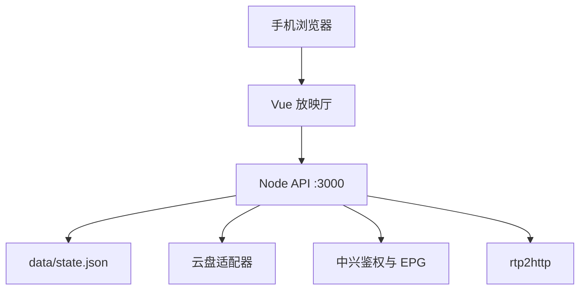

# 架构

单端口对外。生产模式由 Node 托管 `web/dist` 并把 `/api` 留在同进程。

点播：Alist `raw_url`、阿里云盘 download url 优先；需要特殊请求头时走 `/proxy` Range 中转。

直播：HLS/HTTP 直连源地址；RTP/UDP 组播走 `/api/rtp|udp/{group}/{port}`，套接字按观看人数引用计数。
