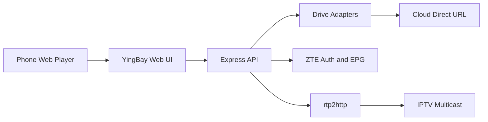

# 映湾 OpenWrt 影视中心

Feature Name: openwrt-media-center
Updated: 2026-10-10

## Description

在 OpenWrt 上提供手机可访问的影视中心：云盘挂载与直连点播、中兴 IPTV 鉴权、EPG、组播 rtp2http。前端为移动优先的单页应用，后端为轻量 Node 服务，配置落在 JSON 文件。

## Architecture

手机只访问路由器上的一个 HTTP 端口。点播默认 302 到云盘 CDN；直播组播由本机加入 IGMP 后转 HTTP MPEG-TS。

## Components and Interfaces

- **Web UI**: Vue 3 放映厅、片库、直播、网盘、设置、播放器。
- **Drive Hub**: demo / webdav / alist / aliyun / local。`GET /api/drives/:id/file` 返回 `directUrl` 与 `relayUrl`。
- **ZTE Client**: 拉取 EncryToken，按 zte-md5 或 hw-ctc 计算口令，提交鉴权，解析频道 XML/JSON，拉取 EPG。
- **rtp2http**: `GET /api/rtp/:group/:port` 与 `GET /api/udp/:group/:port`。
- **Store**: `data/state.json` 保存挂载、IPTV 参数、观看进度。

## Data Models

- Drive: `{ id, name, type, enabled, config }`
- MediaItem: `{ name, path, isDir, size, ext, playable }`
- Channel: `{ id, no, name, group, proto, address, port, playUrl }`
- EpgEvent: `{ channelId, title, start, end }`
- History: `{ key, title, position, duration, driveId, path, at }`

## Correctness Properties

- 直链优先，失败才走中转。
- 组播套接字按观看人数引用计数，人数归零即离开组。
- 鉴权 token 写入 store，重启后先复用再按需重新登录。
- Range 中转必须透传 206 与 Content-Range。

## Error Handling

- 云盘凭证失效：片库显示错误，设置页可重新保存。
- ZTE 鉴权失败：保留上次频道；允许 M3U 兜底。
- 组播无数据：播放器 15 秒无包后提示检查 VLAN/igmpproxy。

## Test Strategy

- 演示片库与公开 HLS 直播在预览环境可完整播放。
- WebDAV/Alist/阿里云盘用用户自有凭证手工验证直链。
- rtp2http 在具备组播的 OpenWrt 上验证；预览环境只验证 HTTP 路由与 RTP 头剥离逻辑。

## References

- 中兴/CTC IPTV 鉴权：AuthenticationURL + EncryToken + UserToken
- udpxy / rtp2httpd URL 习惯：`/udp/239.x.x.x:port`、`/rtp/239.x.x.x:port`
